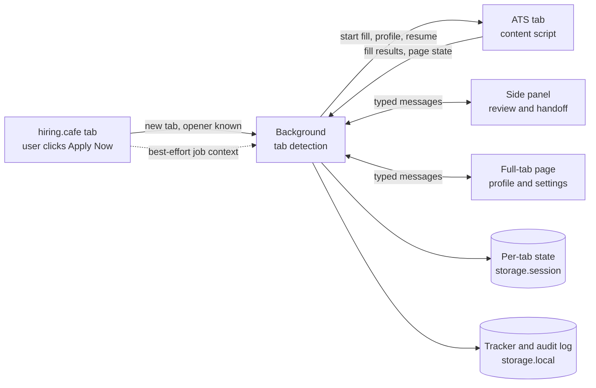

# Architecture

How younimploid fits together. Product requirements are in [SPEC.md](SPEC.md); the reasons behind choices are in [DECISIONS.md](DECISIONS.md). Site adapters and AI are planned; the rest of this page exists.

## Components

| Component | Location | Responsibility |
| --- | --- | --- |
| Background service worker | `src/background/` | Detects tabs opened from hiring.cafe, routes messages, owns per-tab state, gives content scripts files, calls the AI provider |
| Content scripts | `src/content/` | Read and write the ATS page, generic field matcher. May read, never write, the hiring.cafe page for job context. No fetches |
| ATS adapters | `src/content/adapters/` | One small file per ATS, overriding only what the generic matcher gets wrong |
| Side panel | `src/sidepanel/` | Fill status, review, sign-in handoff, tracker |
| Full-tab page | `src/options/` | Profile and settings |
| Shared modules | `src/shared/` | Types, the message union (`messages.ts`), storage modules, prompts |

## Flow

- A tab that didn't come from hiring.cafe starts only from the "Fill this application" button.
- On a sign-in, create-account or verification page, the content script reports it and types nothing. The side panel hands off to the user, and filling resumes when an application form appears.
- The user always submits.

## Storage

All access goes through `src/shared/storage/`, and every read is validated.

`chrome.storage.local`:

| Key | Contents |
| --- | --- |
| `schemaVersion` | Version used by the ordered migrations |
| `profile` | The saved user profile. Has no SSN, government ID, payment or password fields |
| `settings` | User settings. `autoSubmit` is always false for now |
| `applications` | Tracker entries |
| `auditLog` | Append-only, capped record of what was filled and sent |

`chrome.storage.session`:

| Key | Contents |
| --- | --- |
| `tabSession:<tabId>` | Origin, application, step, page state, fill results, paused reason, page URL and the auto-start flag. Survives redirects, cleared when the tab closes. Only trusted extension contexts can read it, so content scripts go through the background |
| `openedFromHiringCafe:<tabId>` | Marks a new tab opened from HiringCafe until it reaches a page off the site |
| `jobContext:<tabId>` | Title, company and URL from the latest Apply click in that HiringCafe tab. Used once, valid for 60 seconds |

IndexedDB (extension origin) holds the resume file. Content scripts cannot read this database directly, so it reaches them through the background.

## Phase plan

The user supplies phases in increments.

### Phase 0: Harness and scaffold (done)

### Phase 1: Pivot and companion foundation

Docs and repo realignment (1.2), storage (1.3), the profile page (1.4), the side panel (1.5) and detection of tabs opened from HiringCafe (1.6) are built.

### Phase 2: Autofill

The generic engine (2.1) and page classifier with sign-in handoff (2.2) are built, in `src/content/engine/`. The background injects `src/content/atsEngine.ts` on each navigation once a tab's engine is active. It asks for the profile and resume with `ENGINE_READY`, reports with `FILL_REPORT`, and takes panel actions through `ENGINE_COMMAND`. Order on a page: classify, attach resume, settle, fill with a wall check before each field, settle, re-read what was written. There is no submit path.
