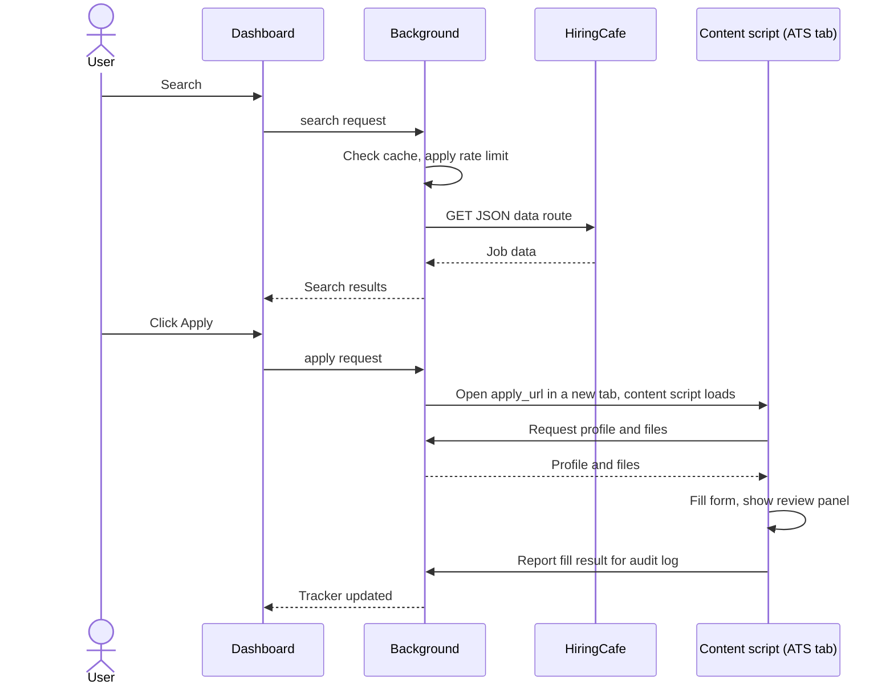

# Architecture

How younimploid fits together. Product requirements are in [SPEC.md](SPEC.md); the reasons behind choices are in [DECISIONS.md](DECISIONS.md).

## Components

| Component | Location | Responsibility |
| --- | --- | --- |
| Background service worker | `src/background/` | All network calls (HiringCafe, AI providers), rate limiter, cache, message router, file access for content scripts |
| Content scripts | `src/content/` | Read and write the ATS page DOM, generic field matcher, review panel (Shadow DOM). No fetches |
| ATS adapters | `src/content/adapters/` | One small file per ATS, overriding only what the generic matcher gets wrong |
| Dashboard | `src/dashboard/` | Full-tab React page opened from the toolbar icon: search, detail, tracker, profile, settings |
| Shared modules | `src/shared/` | Types, the message union (`messages.ts`), storage modules, prompts |

## Message flow

Message names below are illustrative. The real union lives in `src/shared/messages.ts` once it exists.

- The service worker can die at any time, so anything durable goes to storage before a reply is sent.
- Job data comes only from HiringCafe. Posting sites are opened only for the Apply flow, never to collect job information.

## Planned storage keys

`chrome.storage.local`:

| Key | Contents |
| --- | --- |
| `profile` | The saved user profile |
| `settings` | User settings, including auto-submit (off by default) |
| `aiKey` | The user's AI API key. Masked in the UI, never logged |
| `jobStates` | Saved, applied and dismissed states per job |
| `tracker` | Application tracker entries |
| `auditLog` | What was filled and sent for each application |
| `buildIdCache` | The last known HiringCafe `buildId` |

IndexedDB (extension origin) holds resume and template files. Content scripts cannot read this database directly, so files reach them through the background.

## Phase plan

Later phases are added as the user supplies them. The phase list in the spec is reference material, not this plan.

### Phase 0: Harness and scaffold

- **Session 0.1:** rules file and planning docs.
- **Session 0.2:** MV3 + Vite + React + TypeScript + Tailwind + Vitest scaffold. The dashboard opens from the toolbar icon, and a PING/pong message round-trip works.
